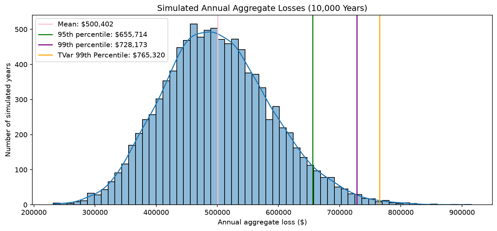
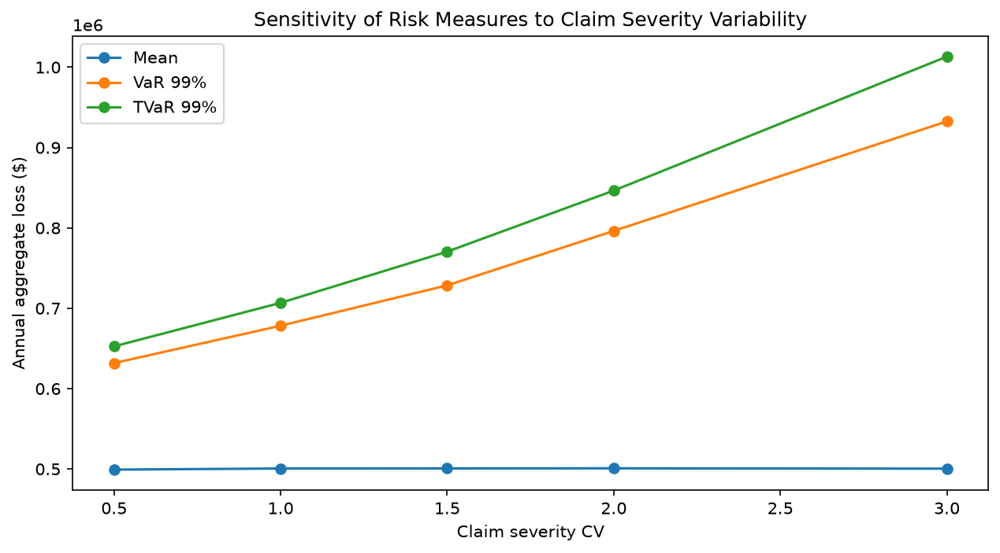

# Monte Carlo Aggregate Loss Model

A Python simulation of annual insurance losses for a portfolio of 1,000 policies, using a compound Poisson–Gamma model to estimate expected losses and tail risk (VaR and TVaR).

## AI Use Disclosure

This project was built with assistance from Claude (Anthropic), used as a tutor and reviewer.

- **My work:** I designed the assumptions, derived the Gamma parameterization from the mean and CV, wrote the simulation, summary statistics, VaR, and TVaR code with hints and feedback, helped with the visualizations, and drafted the written interpretations.
  
- **AI assistance:** Claude structured the project into steps, reviewed and debugged my code, edited my written interpretations, and drafted this README.

I understand and can explain each step of the analysis.

## Overview

Insurers need to know not just their expected annual losses, but how bad a rare year could be. This project simulates 10,000 years of claims to estimate the full distribution of annual aggregate losses, measures tail risk, validates the results against theory, and tests how sensitive the results are to key assumptions.

## Assumptions

| Assumption | Value |
|---|---|
| Policies in portfolio | 1,000 |
| Claim frequency (λ per policy per year) | 0.1 |
| Mean claim severity | $5,000 |
| Severity coefficient of variation (CV) | 1.5 |
| Simulated years | 10,000 |

## Method

- **Frequency:** The portfolio's annual claim count is drawn from a Poisson distribution with mean 100 (1,000 policies × 0.1). Because the sum of independent Poisson variables is also Poisson, one draw represents the whole portfolio.
- **Severity:** Each claim amount is drawn from a Gamma distribution, parameterized from the mean and CV (shape = 1/CV², scale = mean/shape).
- **Aggregation:** Claim amounts are summed for each year, repeated for 10,000 simulated years.

## Key Results

| Measure | Value |
|---|---|
| Mean annual loss | $500,874 |
| Standard deviation | $[your std_loss] |
| VaR 95% | $[your var_95] |
| VaR 99% | $734,731 |
| TVaR 99% | $773,828 |

Losses center around $500,000 with mild right skew. VaR 99% and TVaR 99% are close together, indicating a relatively thin tail at this level of claim variability.

## Validation

Theoretical values were calculated using the compound Poisson formulas, E[S] = E[N]·E[X] and Var(S) = E[N]·Var(X) + Var(N)·E[X]². The simulated mean differed from the theoretical $500,000 by 0.17%, and the simulated standard deviation differed from the theoretical $90,139 by [your std_diff]%, both consistent with normal simulation error.

## Sensitivity Analysis

The simulation was rerun at five levels of severity CV (0.5 to 3.0).

The mean stays flat at about $500,000, but VaR 99% rises from about $[value] to $[value], and the gap between VaR and TVaR widens as the tail grows heavier. Because CV is often the least certain assumption and has the greatest effect on tail risk, it deserves careful estimation.

## Limitations

- Claims are assumed independent; in reality, events like hailstorms or floods can cause many correlated claims at once.
- Parameters are fixed, with no allowance for inflation or trend.
- Results depend on the choice of Gamma severity; a heavier-tailed distribution (such as lognormal or Pareto) could produce substantially higher tail risk.

## Tools

Python · NumPy · pandas · matplotlib · seaborn

## Files

- `Monte Carlo-Final.ipynb`: full analysis with code and commentary
- `loss_distribution.png`, `cv_sensitivity.png`: charts
